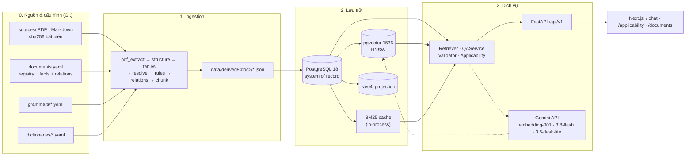
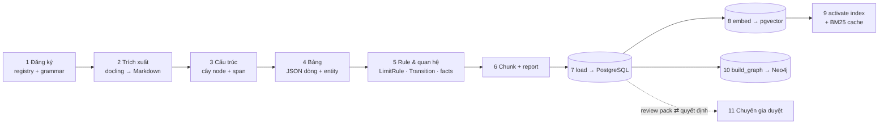
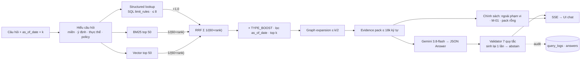

# Hệ thống hóa quy trình data ingestion, retrieval và cách tính điểm

Tài liệu tổng hợp (2026-09-24) mô tả **đúng theo mã hiện tại** ba luồng: (1) ingestion từ văn bản gốc đến evidence chunk / rule / index, (2) retrieval lai và công thức xếp hạng, (3) đường đi từ evidence pack đến câu trả lời có kiểm chứng. Chi tiết từng phần: `docs/retrieval-v1.md`, `docs/qa-v1.md`, `docs/graph-schema-v1.md`, `docs/applicability-rules-v1.md`.

Sơ đồ draw.io (mở bằng draw.io desktop, app.diagrams.net hoặc extension "Draw.io Integration" của VS Code) và ảnh PNG xuất sẵn nằm ở `docs/diagrams/`:

| Sơ đồ | File | Nguồn sinh (drawio-ai-kit) |
|---|---|---|
| Kiến trúc dữ liệu tổng quan | `docs/diagrams/overview.drawio` · `overview.png` | `build_overview.mjs` |
| Pipeline ingestion chi tiết | `docs/diagrams/ingestion-pipeline.drawio` · `.png` | `build_ingestion.mjs` |
| Retrieval lai và tính điểm | `docs/diagrams/retrieval-scoring.drawio` · `.png` | `build_retrieval.mjs` |

Sơ đồ được sinh bằng [drawio-ai-kit](https://github.com/sparklabx/drawio-ai-kit) (layout engine khai báo, không tọa độ tay; devDependency trong `docs/diagrams/package.json`) và xuất PNG bằng draw.io desktop: `cd docs/diagrams && npm install && npm run build && npm run render`. Cách cài, dùng, gỡ: `docs/diagrams/README.md`; so sánh với drawio-skill và quyết định giữ kit: `docs/reports/diagram-tooling-eval-2026-09-24.md`. Bên dưới mỗi phần có bản Mermaid rút gọn để đọc ngay trên GitHub/VS Code.

## 1. Kiến trúc dữ liệu tổng quan




Nguyên tắc: PostgreSQL là hệ thống lưu trữ chính (mọi bảng trong `backend/app/db/models.py`); pgvector và BM25 là chỉ mục dẫn xuất; Neo4j là bản chiếu để đối chiếu/duyệt, chưa dùng trong lúc trả lời. Gemini chỉ được gọi ở hai chỗ: embedding và sinh câu trả lời/hiểu câu hỏi. Không có LLM trong ingestion.

## 2. Pipeline ingestion


Lệnh: `python scripts/ingest.py <stage>` với `pdf | structure | tables | all | report | load | db | embed | activate | bm25` (`--doc ID` lặp lại được; chi tiết `README.md`). Mã: `backend/app/ingestion/`, `backend/app/db/loader.py`, `backend/app/retrieval/index.py`, `backend/scripts/build_graph.py`.

| Bước | Đầu vào | Xử lý (module) | Đầu ra / artefact | Kiểm tra bắt buộc |
|---|---|---|---|---|
| 1. Đăng ký | `sources/<file>`, `data/registry/documents.yaml` | `registry/loader.py`: hash sha256, `text_status` (official / draft / unverified), registry facts (`from_text` hoặc `admin_declared`), quan hệ REPLACES/REPEALS/PROMULGATES/REFERENCES, stub văn bản ngoài corpus | `documents`, `document_versions`, `registry_facts`, `document_relations` khi load | hash khớp file; văn bản dự thảo không có fact `from_text` cho ngày ký/hiệu lực (ADR-0004) |
| 2. Trích xuất & chuẩn hóa (`pdf`) | PDF | `pdf_extract.py` (docling, cache theo lô, ADR-0009) → Markdown + `pdf_page`, `printed_page`; `sanitize.py`, `textnorm.py`: `normalize_legacy_text` (font cũ, khoảng trắng chèn), `strip_noise_lines`, `latex_to_text` | `data/derived/<doc>/pdf_extract/` | 20 chunk ngẫu nhiên đối chiếu trang PDF (spike) |
| 3. Cấu trúc (`structure`) | Markdown + `grammars/<doc>.yaml` | `structure_parser.py`: regex theo grammar (`structure[]`, `block`, `parent_kinds`) → cây node Chapter/Section/Article/Clause/Point/Definition/Table/Footnote/Appendix/Preamble, mỗi node có `SourceSpan`; `scope.py` gắn phân vùng TT10 (`in_scope` / `structure_only`, ADR-0008) | `structure.json` | 100 % dòng không rỗng thuộc đúng 1 node (`coverage_ratio`), số thứ tự liên tục, PDF có `pdf_page` |
| 4. Bảng (`tables`) | cây node + `tables{}` trong grammar | `table_parser.py`: header nhiều tầng, trục điều kiện (`header_condition_axis` F ≤/> 2000), `zone_axis` A/B/C, phân cấp thiết bị, `<br>` → dòng logic, `value_grammar` (≤ giá trị, khoảng, O₂ tham chiếu); `resolve_entities.py`: thông số/đơn vị/thiết bị/loại hình → id từ điển | `tables.json` (JSON mỗi dòng theo `docs/table-row-json-spec.md`) | 0 ô không parse im lặng: ô lạ → `op=unparsed` + `parse_warnings`; entity không khớp → `unresolved_entities` |
| 5. Rule & quan hệ (`all`) | tables, structure, registry | `extract_rules.py`: TableRow × cột → `LimitRule` (op, value/min/max, unit, ref_o2, conditions, exceptions, `review_status=pending`); `extract_relations.py`: REPLACES/REPEALS/TransitionRule/registry fact `from_text`; `extract_monitoring.py`: bản đồ curated TT10 → MonitoringRequirement | `rules.json`, `relations.json`, `monitoring.json` | quan hệ trích từ văn bản phải khớp registry (`mismatches` lên report); rule luôn `pending` cho đến khi chuyên gia duyệt |
| 6. Evidence chunk | mọi artefact trên | `chunk.py`: chunk theo node (clause/point/definition/preamble), theo dòng bảng, chú thích, registry fact, monitoring; mỗi chunk có `citation_label` (PLAN Phụ lục B), `context_text` (nhãn + ngữ cảnh cho BM25/embedding), miền, `text_status`, span | `chunks.json`, `report.json` | chunk `structure_only` không được tạo; `report.json` ghi coverage, số node/dòng/rule/chunk, warnings |
| 7. Nạp (`load`) | `data/derived/<doc>/` | `db/loader.py::load_document`: xóa-chèn toàn bộ artefact **theo văn bản**, giữ embedding của chunk có `md5(context_text)` không đổi; upsert registry + stub | bảng `structure_nodes`, `table_defs`, `table_rows`, `limit_rules`, `transition_rules`, `monitoring_requirements`, `evidence_chunks`, `ingestion_runs` | `ingest.py db` đếm dòng; test `test_db_load` |
| 8. Embedding (`embed`) | chunk chưa có vector của model | `retrieval/index.py::embed_pending`: Gemini `gemini-embedding-001` @1536, `RETRIEVAL_DOCUMENT`, chuẩn hóa L2, lô 32, retry; `record_index_version` ghi `index_versions` (`building` → `inactive` khi đủ) | `evidence_chunks.embedding` (HNSW) | dim = 1536 (`EMBEDDING_DIM`), `--dry-run` ước lượng trước |
| 9. Kích hoạt (`activate`, `bm25`) | `index_versions` | đúng một index `active` (UC-08); rebuild BM25 cache `data/derived/index/bm25-<md5>.pkl` (chữ ký = md5 nội dung mọi chunk → tự rebuild sau ingest); backend nạp BM25 + alias lúc khởi động | index `active`, cache BM25 | `/search` cảnh báo khi chưa có index active |
| 10. Graph (`build_graph.py`) | PostgreSQL | `graph/build_graph.py`: MERGE theo `id`, `projection_version`, xóa node cũ → 21 label, ≈ 30 loại edge | Neo4j (5.913 node / 17.106 edge) | `test_graph.py`: idempotent, đường bằng chứng Neo4j = Postgres |
| 11. Kiểm duyệt | PostgreSQL | `scripts/review_pack.py` → Excel 17 sheet → chuyên gia → `scripts/review_import.py` → `review_decisions`, cập nhật `review_status` (bulk theo bảng + kiểm mẫu ≥ 10 %, PLAN §11) | `review_decisions` | quy trình `docs/review/quy-trinh-kiem-tra-chuyen-gia.md` |



Bất biến xuyên suốt: parser xác định theo grammar (không hard-code văn bản, không LLM); mọi ô/dòng không parse được phải lên report hoặc review task; văn bản dự thảo luôn `draft` và ngày ký/hiệu lực chỉ lấy từ registry fact do quản trị viên khai báo; mọi chunk mang `citation_label` + span để trích được tận dòng nguồn.

## 3. Retrieval lai và cách tính điểm


Mã: `backend/app/retrieval/` (`query.py`, `structured.py`, `lexical.py`, `vector.py`, `retriever.py`, `expand.py`). API: `POST /api/v1/search`.

### 3.1 Các bước

| Bước | Việc | Tham số |
|---|---|---|
| 1. Hiểu câu hỏi (rule-based) | `tokenize` (pyvi) + `AliasIndex` khớp dài-nhất-trước → thông số, đơn vị, cột/vùng, lưu lượng, nhiên liệu/công suất, nguồn tiếp nhận, mã văn bản; miền (wastewater / emission / cross_domain / out_of_scope / unknown) từ từ khóa + miền của thông số/văn bản; ý định theo ưu tiên frequency → effectivity → method → sampling → definition → applicability → threshold → scope; `policy=M-01` khi hỏi tần suất; `needs_llm` khi miền unknown/cross hoặc ý định other (QA gọi Gemini 3.5-flash-lite phân loại lại) | `data/dictionaries/aliases.yaml` |
| 2. Structured lookup | chỉ khi ý định threshold/applicability/other **và** có thông số: SQL `limit_rules` lọc bảng theo miền, `parameter_id`, `zone`; lọc chế độ lưu lượng F ≤ 2000 / F > 2000, dòng T-P theo nguồn tiếp nhận, nhiên liệu/công suất QCVN 19 (`applicability/matching.py`); xếp theo độ đặc hiệu: +2 khớp nhiên liệu, +2 khớp đơn vị công suất, +1 nhãn thiết bị lặp từ khóa câu hỏi, −1 dòng "khác"; hòa → vị trí trong văn bản | ≤ 8 dòng |
| 3. BM25 | truy vấn = token câu hỏi + token chuẩn (`param_bod5`, `unit_mg_l`, `doc_qcvn_40_2025`, `ctype_table_row`); `rank_bm25` trên `context_text`; bỏ điểm ≤ 0; lọc miền `{miền, both}` (cross/unknown: không lọc) | top 50 |
| 4. Vector | câu hỏi gốc → Gemini `RETRIEVAL_QUERY` @1536 → cosine pgvector; cùng lọc miền; lỗi API → bỏ nhánh + cảnh báo | top 50 |
| 5. Hợp nhất | RRF + thưởng structured (mục 3.2) | `RRF_K = 60` |
| 6. Boost & lọc | nhân `TYPE_BOOST[ý định][loại chunk]`; loại chunk của văn bản chưa hiệu lực tại `as_of_date` (trừ ý định effectivity/applicability); sắp xếp giảm dần, lấy top k | k mặc định 8 (`/search`), 10 (QA) |
| 7. Graph expansion | thêm ≤ `max(2, k//2)` chunk theo thứ tự ưu tiên (mục 3.3), không có điểm, nối sau top k | `PostgresGraphStore` |
| 8. Evidence pack | nạp toàn văn theo thứ tự, dừng khi vượt 18.000 ký tự; mỗi mục: `rank`, `chunk_id`, `citation_label`, văn bản, loại, miền, `text_status`, điểm, nguồn | `CHAR_BUDGET = 18000` |

### 3.2 Công thức điểm

```text
score(c) = Σ_{s ∈ {bm25, vector}} 1 / (60 + rank_s(c))        # Reciprocal Rank Fusion, k = 60
         + 1,0                                                  # nếu c là dòng structured lookup
ranked(c) = score(c) × TYPE_BOOST[intent].get(chunk_type, 1,0)  # sau khi lọc hiệu lực
```

| Thành phần | Ý nghĩa | Số liệu |
|---|---|---|
| RRF k = 60 | chỉ dùng thứ hạng, không dùng điểm thô (BM25 và cosine khác thang); k lớn làm đường cong phẳng → "có mặt ở cả hai danh sách" quan trọng hơn "đứng cao ở một danh sách" | hạng 1 = 1/61 ≈ 0,0164; hạng 10 ≈ 0,0143; hạng 50 ≈ 0,0091; cả hai nguồn hạng 1 = 0,0328 |
| Thưởng structured +1,0 | lớn hơn mọi tổng RRF có thể (tối đa ≈ 0,033) → dòng ngưỡng khớp điều kiện luôn đứng đầu, giữ thứ tự đặc hiệu của bước 2 | nguồn ghi `structured` (+ `bm25`/`vector` nếu cũng được tìm thấy) |
| `TYPE_BOOST` | threshold: table_row 1,3 · footnote 1,1; method: table_row 1,2 · clause 1,1; effectivity: registry_fact 1,4 · clause 1,2 · preamble 1,2 · point 1,1; applicability: clause 1,2 · point 1,2; definition: definition 1,5; sampling: clause 1,2 · paragraph 1,1; frequency: clause 1,2 | chỉ sắp xếp lại trong cùng thang RRF; không đảo được structured |
| Lọc hiệu lực | `as_of_date < effective_date` (registry fact không scope) → bỏ chunk của văn bản đó, trừ khi hỏi về hiệu lực/áp dụng | PLAN §8 quy tắc 5 |

Ví dụ "Giới hạn BOD5 cột B, lưu lượng 3000 m³/ngày":

| Chunk | BM25 | Vector | Structured | score | × boost (threshold) |
|---|---|---|---|---|---|
| Bảng 1 TT 1 BOD5 (dòng F > 2000, cột B) | hạng 2 → 0,0161 | hạng 1 → 0,0164 | +1,0 | 1,0325 | 1,342 |
| Mục 2.1 (đoạn dẫn Bảng 1) | hạng 1 → 0,0164 | hạng 4 → 0,0156 | – | 0,0320 | 0,032 |
| Chú thích Bảng 1 | hạng 12 → 0,0139 | – | – | 0,0139 | 0,0153 |

### 3.3 Graph expansion (thứ tự = ưu tiên, quota `max(2, k//2)`)

1. `policy = M-01` → hai chunk Điều 16 khoản 3 và Điều 17 khoản 5 TT 10/2021 (theo nhãn trích dẫn).
2. Đã nhận diện cột A/B/C và ý định threshold/applicability/scope → chunk `point` "Cột X:" của QCVN 40 (Mục 1.3.3.x) hoặc QCVN 19 (Mục 1.3.13.x) theo miền.
3. Với 5 chunk đầu: dòng bảng → chú thích qua `footnote_refs`; khoản/điểm/đoạn → khoản cha qua `parent_id`.
4. Chunk `definition` có thuật ngữ (phần trước dấu ":") xuất hiện trong câu hỏi.
5. Ý định effectivity/applicability: mở rộng tập văn bản qua `document_relations` 2 vòng (REPLACES/REPEALS → văn bản mới; PROMULGATES/PROMULGATED_BY → cả hai) rồi thêm Lời nói đầu, chunk của `TransitionRule`, chunk `registry_fact`.

Mỗi lần thêm kiểm tra chunk tồn tại, chưa có trong pack, chưa vượt quota. Đường bằng chứng cho UI (`GET /graph/evidence-path/{chunk_id}`) leo `parent_id` từ node nguồn (Postgres) hoặc `CONTAINS*` (Neo4j), loại `LegalDocument`/`Boilerplate`; hai cách cho cùng kết quả (test).



## 4. Từ evidence pack đến câu trả lời (tóm tắt, chi tiết `docs/qa-v1.md`)

1. Trả lời theo chính sách, không gọi LLM: ngoài phạm vi, M-01 tần suất (trích Điều 16.3/17.5 + chỉ dẫn NĐ 08/2022), cần làm rõ, pack rỗng.
2. Gemini `gemini-3.8-flash`, `temperature 0`, `response_schema=Answer`, `thinking_level=low` (medium cho hiệu lực/áp dụng/cross), system prompt ổn định, câu hỏi bọc như dữ liệu, evidence là thẻ `<chunk id label document [BẢN DỰ THẢO]>`, streaming.
3. Validator: citation bắt buộc; mọi `chunk_id` ∈ pack; mọi số trong kết luận/căn cứ có trong chunk trích (chuẩn hóa `0,05`/`3.000`/`50.0`, số lặp từ câu hỏi được phép); miền khác → cảnh báo/reject; dự thảo → cảnh báo bắt buộc; hiệu lực TT45/TT10 phải trích Sổ đăng ký; reject → sinh lại 1 lần kèm lỗi → abstain chuẩn (`status=failed`).
4. Audit: `query_logs` (understanding, chunk đã lấy + nguồn + rank, model, prompt version, usage, latency, validator), `answers`, `answer_citations`, `feedback`.

## 5. Chỗ nối để mở rộng

- Thêm văn bản: entry registry + grammar YAML + (nếu bảng ngưỡng) `tables{}`/`zone_axis` + từ điển; các chỗ còn cứng theo 2 miền được liệt kê trong `docs/production-readiness-proposal.md` §3.1 (bước 0).
- Thay điểm số: `RRF_K`, `TYPE_BOOST`, mức thưởng structured trong `retriever.py`; đo lại bằng `scripts/eval.py` trên gold set trước khi đổi.
- Thay index: `ingest.py embed` với model mới → `index_versions` mới → `activate` (index cũ giữ để rollback).
